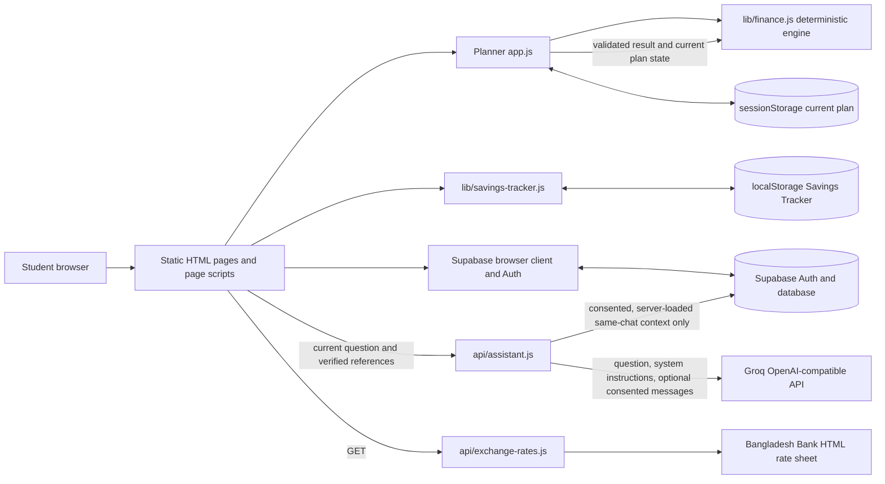

# CampusBridge AI — Technical Documentation

**Submission reference for FinTechathon 2026, Theme C**
**Repository audit date:** 20 October 2026

This document describes behavior found in the repository source and tests, plus the explicitly dated public checks in the production verification record. The public site and exchange-rate API were reachable during this audit, but that does not certify Vercel project settings, Supabase policies, secret configuration, Groq availability, or real-user isolation. The local test results establish only the tested local behavior.

## 1. Project overview

CampusBridge AI is a student-facing prototype for organizing study-abroad tuition costs, available funds, savings assumptions, exchange-rate references, and manually collected payment-provider quotes. It aims to make those assumptions visible and explainable so a student can inspect a funding estimate and a time-based savings plan.

The financial engine is deterministic application code. It validates inputs and calculates totals, funding gaps, schedules, quote eligibility, and scenarios. The AI assistant explains general concepts and can use explicitly consented recent messages from the selected saved chat; it is not the financial calculation engine and does not receive the user's saved plans, balances, or quotes.

The application does not connect to a bank, verify a manually entered provider quote, issue a payment, or guarantee rates, fees, admission, visas, affordability, or funding. A Bangladesh Bank reference rate is not a student's executable payment price.

## 2. Scope and system boundaries

### In scope

- A browser planner with two modes: **All Study-Abroad Costs** and **Tuition Only**.
- Planning in 18 supported currencies: BDT, USD, EUR, GBP, AUD, JPY, CAD, SEK, SGD, CNH, INR, LKR, DKK, NZD, NOK, KRW, CHF, and AED. Bangladesh Bank reference rates remain available only for the 11 currencies published in its feed; the additional six currencies require a manually sourced rate.
- Local, deterministic planning, contribution schedule, roadmap, stress scenarios, and report generation.
- On-demand Bangladesh Bank reference-rate retrieval through a same-origin Vercel function.
- Validation and ranking of student-entered transfer quotes.
- An explanatory AI assistant with a separate deterministic task router.
- Optional account features using Supabase Auth, cloud-saved plans, and persistent signed-in chat.
- A browser-local Savings Tracker with JSON backup and restore.

### Out of scope

There is no bank-account connection, automatic balance import, live payment-provider quote feed, payment initiation, money transfer, lending decision, or financial-advice guarantee. The code and test suite do not establish production availability or a regulatory/compliance certification.

## 3. System architecture



The pages are static HTML, CSS, and browser JavaScript. Shared business rules are in `lib/`; page-specific interactions are in `app.js` and `js/`. The two files in `api/` follow Vercel's serverless-function convention. There is no frontend bundler or build script in `package.json`; the only declared npm dependency is the `openai` SDK used by the assistant route. Supabase JS v2 is loaded by the pages from a browser CDN.

### Major modules

| Module | Responsibility |
| --- | --- |
| `app.js` | Planner form, currency selection, input normalization, rate controls, rendering, quote entry, and planner actions. |
| `lib/finance.js` | Input validation, currency conversion, funding calculations, date schedules, quote validation/ranking, stress scenarios, and report data. |
| `lib/assistant-task.js` | Routes supported requests using the active validated planner state and finance functions; it does not send planner state to Groq. |
| `lib/plan-state.js` | Versioned, field-allowlisted current plan state in tab-scoped `sessionStorage`; restored values are validated and recalculated. |
| `lib/planner-results.js` | Maps validated finance results to result summaries and dated roadmap data. |
| `lib/bangladesh-bank-rates.js`, `lib/exchange-rates.js` | Parses the published HTML, validates API data, keeps source/time metadata, computes stale state, and maps rates into the planner. |
| `api/exchange-rates.js` | Fetches rates server-side and sets response-cache headers. |
| `lib/assistant-chat.js` | Browser-side saved-chat operations using the signed-in Supabase client. |
| `lib/assistant-context.js` | Server-side JWT, ownership, latest-message, and bounded-context verification for saved chats. |
| `api/assistant.js` | Validates assistant requests, applies an in-memory limiter, optionally loads consented context, and calls Groq. |
| `lib/cloud-plans.js` | Validated, explicit save/list/load/rename/delete operations for `saved_plans`. |
| `lib/savings-tracker.js` | Local roadmap snapshots, BDT deposits, comparisons, and backup/import validation. |
| `lib/mfa-flow.js` | Supabase authenticator enrollment and TOTP challenge flow. |
| `js/planner-steps.js` | Guided planner steps; financial steps remain inside the currency-gated fieldset. |

## 4. Main user workflows and data flows

### Create a financial plan

1. A new planning session begins with a choice from the 18 planning currencies. `planner.html` keeps financial inputs in the disabled and hidden `#planningDetails` fieldset until selection. A signed-in profile's saved study destination selects its corridor and matching currency when the plan has no entries; a populated plan is preserved and the user is told why the preference was not applied.
2. `app.js` updates labels using `Finance.CURRENCY_NAMES` and `Finance.CURRENCY_SYMBOLS`. The user enters tuition, rate/source/time, funds, costs, income/expenses, and a deadline.
3. The planner converts selected-currency monetary entries to BDT for the finance engine. It passes tuition in the selected currency with a rate expressed as BDT per selected-currency unit.
4. `lib/finance.js` validates the profile and calculates results locally. The planner stores validated inputs, not trusted calculated output, in tab `sessionStorage` through `lib/plan-state.js`.
5. The roadmap, report, stress-test page, and other dependent views restore validated inputs and recalculate locally.

### Change planning currency

When a populated unsaved planner session changes currency, `app.js` explains that it starts a new plan and requests confirmation. Cancel restores the previous selection. Confirm clears the current planner form and active plan state, then selects the new currency. Historical local roadmaps and explicit cloud-saved plans are separate records and keep their original currency.

DKK, NZD, NOK, KRW, CHF, and AED are supported for manually sourced, timestamped rates only; Bangladesh Bank's published-rate feed continues to cover its existing 11 currencies.

### Compare provider quotes

The user selects a destination corridor, requests a quote through their chosen provider, and enters quote details. The browser validates and ranks only eligible entries locally. Quote values are not imported from providers and are not authenticated by the app.

### Use the assistant

`lib/assistant-task.js` checks whether the question is a supported planning task. It uses the current validated plan and `lib/finance.js` for deterministic answers. If required inputs are absent or invalid, it asks for the missing value instead of supplying one. Other questions can be sent to `/api/assistant`.

For a saved signed-in chat, the browser persists the submitted question and displayed answer to Supabase. The optional history checkbox is off by default. If the user opts in, the server verifies the selected conversation and current message, then loads a bounded recent history from that conversation. That prior text, which can contain sensitive information, is sent to Groq only for that request. The server does not load cloud plans, balances, quotes, or other database rows as model context. With consent off or for signed-out chat, the model receives only the current question (plus system instructions).

## 5. Financial methodology and assumptions

### Currency and conversion direction

The planner stores the selected planning currency in `tuitionCur`. The exchange-rate convention is:

> `exchangeRate` = BDT per 1 unit of the selected planning currency.

For example, if the user provides `123.4 BDT/USD`, then `10 USD × 123.4 = 1,234 BDT`. `Finance.convert()` uses the reference-unit ratio `amount × unitsPerReference[to] / unitsPerReference[from]`. For a non-BDT planning currency, `app.js` uses `{ BDT: rate, [currency]: 1 }`, so user-entered savings, account balances, emergency funds, committed funds, optional costs, income, and expenses are converted to BDT before they are combined. Tuition is multiplied by the same rate inside the finance engine. BDT plans use a same-currency rate of one.

Calculated results use the BDT calculation base. Display helpers convert results back using the same rate. Destination country and transfer quote currency are separate selections; a quote's sender principal/cost is in BDT and its recipient amount is in the quote currency. The planner does not add amounts from different currencies without conversion.

### Funding requirement and funding gap

In BDT terms:

```text
tuitionBdt = tuitionInPlanningCurrency × BDTPerPlanningCurrency
initialLivingCosts = sum(monthlyLivingCostCategories) × enteredWholeMonthPeriod
requiredFunds = tuitionBdt + paymentTransferFees + oneTimeCosts + initialLivingCosts
usableFunds = max(0, savings − protectedEmergencyFund − committedFunds)
fundingGap = max(0, requiredFunds − usableFunds)
monthlySurplus = monthlyIncome − monthlyLivingCosts
```

The All Study-Abroad Costs mode includes optional visa, application, flight, insurance, document, accommodation-deposit, setup, other one-time, and initial living-cost entries. Blank optional costs are not invented. A positive monthly living-cost estimate requires an explicit whole-month period. Tuition Only uses a calculation copy with those optional costs removed; the user's form values remain separate from that mode-specific calculation.

Monetary inputs are capped at 1,000,000,000,000 in their entered currency. Calculated BDT results are also capped at 1,000,000,000,000. Invalid, non-finite, or over-limit calculations are rejected. The finance module retains precision for calculations; rounding is for display and the whole-BDT contribution schedule.

### Savings schedules and roadmap

Only complete 30-day intervals before the deadline count:

```text
contributionCycles = floor(calendarDaysToDeadline / 30)
exactMonthlyTarget = fundingGap / contributionCycles   (when gap > 0 and cycles > 0)
projectedCapacity = max(0, monthlySurplus) × contributionCycles
projectedShortfall = max(0, fundingGap − projectedCapacity)
```

When the app shows a whole-BDT contribution schedule, regular cycles use the floor of the gap divided by the cycle count and the final cycle is adjusted upward to cover any remaining fractional BDT. A positive gap with no full cycle has no dated monthly target. The roadmap uses calendar dates at 30-day intervals and displays up to 120 rows; the projection is not truncated at 120. It separates required contributions from capacity-based projected balances. These are estimates that assume the student makes contributions and that stated conditions do not change.

### Transfer quote validation and ranking

The quote form requires a provider name, matching recipient currency, total sender cost in BDT, recipient amount, local timestamp, and source/reference. Values must be finite and within the 1e12 safety bound; sender cost must be at least the principal. Timestamps in the future or more than 24 hours old are excluded. Delivery time is optional except for speed ranking, where a supplied estimate must be a whole number from 0 through 365. Eligible quotes can be ranked by lowest sender cost, highest recipient amount, or fastest provided delivery estimate. These checks validate entered fields; they do not authenticate the provider, reference, quote validity, route, expiry, or included fees.

### Stress scenarios and reports

Stress scenarios recalculate copies of the baseline with a 5% or 10% higher rate, an explicitly entered monthly expense increase, and/or one missed contribution. They do not mutate the baseline; no expense increase is assumed if none is provided. The browser-generated readiness report and downloadable text report use validated inputs and deterministic finance results. Monetary summaries use the selected planning currency and identify the BDT basis/rate; transfer quote sender cost stays explicitly in BDT. An optional report name is used for that local report and is not saved as plan state.

## 6. Bangladesh Bank reference-rate integration

`GET /api/exchange-rates` calls `fetchBangladeshBankRates()` in `lib/bangladesh-bank-rates.js`, which requests the published Bangladesh Bank FX Rate Sheet as HTML. The parser expects an effective-date heading and a table with currency, bid, and ask columns. It supports USD, EUR, GBP, AUD, JPY, CAD, SEK, SGD, CNH, INR, and LKR. It validates the date and positive finite rates up to 1e12. USD is represented as the USD/BDT interbank rate; the other published rows are treated as Bangladesh Bank cross rates quoted as BDT per one unit of the row currency. The planner uses the ask as an estimate and retains bid/ask, rate type, publication date, retrieval time, and source URL.

The HTML parser is coupled to the published page layout. A changed heading, table structure, or unsupported missing row can make the request fail and require code maintenance. Tests use saved HTML fixtures; they do not prove that the live page currently has the expected layout.

Successful API responses use `Cache-Control: public, max-age=0, s-maxage=86400`: the Vercel shared cache TTL is 24 hours, best-effort and potentially regional. The browser also reuses a successful retrieval for its 24-hour retrieval window. The response does **not** set `stale-if-error`; upstream or validation failures return `502` with `Cache-Control: no-store`, so no durable last-good store is implemented by this endpoint. The page keeps an already-held response in browser memory when a refresh fails and does not overwrite a separately entered manual rate.

The UI marks data stale if the response says so, Vercel reports a stale cache response, the publication date is at least five days old, or a successful retrieval is at least 24 hours old. It displays publication and retrieval dates. A stale official response cannot be applied as current. A successful fresh response starts a 30-minute request cooldown; a failed request or stale response sets a 30-second retry delay. Browser cache and retry behavior are client-side and do not establish production CDN behavior.

## 7. AI behavior and request boundaries

The request route is `api/assistant.js`. The frontend sends JSON with a current `question`; only saved conversations add a conversation ID, current message ID, and optional `includeHistory: true` consent. Browser-supplied message arrays, financial profiles, balances, quotes, and plan records are rejected. The question limit is 1,000 characters and the JSON body limit is 4,096 bytes.

For saved-chat references, `lib/assistant-context.js` requires a bearer token and server-side `SUPABASE_URL` plus `SUPABASE_PUBLISHABLE_KEY`. It asks Supabase Auth to validate the token, verifies the conversation belongs to the authenticated user through PostgREST under that same user's JWT, and checks that the referenced current user message is the latest eligible question and exactly matches the submitted text. Retrieval failures fail closed. If consent is enabled, up to 40 database rows are queried to assemble at most 11 prior messages plus the current question (12 total) and no more than 6,000 characters. Messages are kept chronological and current text appears once. These are size limits, not a tokenizer guarantee.

Consented prior text is free-form conversation content; the system does not claim that it is automatically free of sensitive details. The user must understand that prior messages from the same saved chat can be sent to Groq after opting in. The model prompt says not to claim memory when history is absent and not to calculate authoritative personal results. For a supported exact tuition-recall pattern, `api/assistant.js` can extract a previously stated amount from authorized messages and answer deterministically without calling Groq. This recall is not a general financial calculation feature.

The remote API uses the OpenAI-compatible `openai` SDK with Groq's base URL. Default model: `openai/gpt-oss-20b`; `GROQ_MODEL` can override it. The SDK timeout is 30 seconds; requested completion limit is 4,096 tokens; returned text is capped at 16,000 characters. The in-memory limiter allows 12 requests per IP per 15-minute window per function instance, not globally. It can return `429` with `Retry-After`; serverless instance restarts/replicas limit its enforcement scope. `lib/assistant-renderer.js` uses DOM-safe rendering for returned Markdown.

## 8. Authentication, authorization, and data storage

| Data | Storage | Meaning and limit |
| --- | --- | --- |
| Active planner inputs and stress inputs | `sessionStorage` via `lib/plan-state.js` | Versioned and field-allowlisted; shared across same-origin pages in that tab. Not encrypted or an account backup. |
| Cloud-saved plans | Supabase `saved_plans` via `lib/cloud-plans.js` | Explicitly saved input copies. Load validates inputs and recalculates locally. Schema and production RLS state are not verified here. |
| Signed-in chat conversations/messages | Supabase `assistant_conversations` and `assistant_messages` via `lib/assistant-chat.js` | Separate from plans; user questions and displayed answers persist. The intended additive schema/RLS/grants are described in `docs/supabase-assistant-chat.sql`; application to a live project is unknown. |
| Signed-out chat | Current page memory | Temporary; no saved conversation reference or historical context. |
| Savings Tracker roadmaps and deposits | Browser `localStorage` via `lib/savings-tracker.js` | Browser-profile-only historical snapshots and BDT deposits. JSON backup/restore is available; not synced to Supabase or bank-verified. |
| Supabase Auth session | Supabase JS browser client storage defaults | Browser session behavior; not a secure vault on an untrusted device. |

The account page uses Supabase Auth email/password, Google sign-in, recovery, and optional TOTP MFA. The cloud-plan module checks the authenticated user and, where an enrolled verified factor is present, requires AAL2 for protected plan operations. The assistant-chat client does not implement that same explicit AAL2 gate. Supabase Row Level Security is the database authorization boundary; client-side user filters are defense in depth. The repository contains intended chat policies and a separate MFA policy artifact, but only the live database can establish which policies and grants are active.

Server environment variable names in `.env.example` are `GROQ_API_KEY`, `SUPABASE_URL`, and `SUPABASE_PUBLISHABLE_KEY`. `GROQ_MODEL` is optional and defaults in source. The Supabase URL/publishable key are also configured in `js/supabase-config.js` for browser Supabase access. A publishable key is designed to be public and does not replace RLS. No service-role key is used by the assistant context code. This document intentionally contains no environment values.

## 9. Security, privacy, and limitations

- Current plan calculations and quote validation run locally. The model does not receive saved plans, account balances, quote rows, or calculation results from storage.
- Saved-chat history is sent to the AI provider only after explicit opt-in for that request. It can include personal or financial details typed in that chat. Without consent, no earlier message text is sent.
- Server-side conversation checks use the user's token and RLS, but this repository cannot prove the live RLS state or successful two-user isolation in a deployed project.
- Browser storage is not encrypted. Same-origin scripts can access it; this is not suitable as a secure vault for credentials or bank secrets.
- The assistant limiter is per process/instance and is not a global abuse-control system. API and upstream availability depend on Vercel, Supabase, Groq, and Bangladesh Bank.
- Manual quotes are not verified. The official rate parser depends on a public HTML layout. Stale-if-error is not configured; Vercel cache behavior and rate freshness have not been checked in production as part of this document.
- Optional MFA and intended database policies require configuration and verification in the actual Supabase project. SQL files are reviewable artifacts, not proof of execution.
- No legal, regulatory, accessibility, penetration, load, uptime, or production certification is claimed.

## 10. Tests and verification scope

Run the built-in Node test runner from the repository root:

```powershell
node --test "tests/*.test.cjs"
git diff --check
```

`package.json` declares no `test` script, so `npm test` is not the repository's test command. The suite uses Node's built-in `node:test` runner and covers financial formulas and bounds, date handling, currencies, exchange-rate fixtures/cache logic, quote validation, assistant request/context security, auth/MFA flows, storage behavior, and static page structures. Tests do not connect to the live Bangladesh Bank site, Groq, Vercel, or Supabase; they do not apply SQL, prove deployed RLS, or replace browser/manual checks.

### Audit run recorded for this document

The current test run and `git diff --check` are recorded in [the testing and deployment guide](test-results.md). Results are local repository checks only and should be refreshed after future source changes.

## 11. Local setup and deployment

### Windows local development

From PowerShell in the repository folder:

```powershell
node --version
npm ci
```

Use Node.js 22 or newer. For the full app with Vercel API routes, create `.env.local` from `.env.example` only if `.env.local` does not already exist. This avoids overwriting existing local configuration. Edit the private file locally and enter the required server settings without copying them into source files:

```powershell
if (-not (Test-Path .env.local)) { Copy-Item .env.example .env.local }
notepad .env.local
npx vercel@latest dev --listen 3000
```

Open `http://localhost:3000`. The remote assistant needs `GROQ_API_KEY`; saved-chat ownership verification also needs server-side Supabase URL and publishable key. Supabase browser Auth depends on the values in `js/supabase-config.js` and the configured project. Do not replace a publishable key with a service-role key. A static-only preview can use `py -m http.server 8000`, but it does not provide `/api` routes.

### Deployment

The repository uses Vercel's `api/` convention and has no checked-in `vercel.json` or build script. The active Vercel project, Git connection/production branch, environment scopes, domains, and deployment settings are not verified. Confirm those in the project dashboard; preview first. Configure server variables privately in Vercel, confirm `js/supabase-config.js` points at the intended Supabase project, review live tables/grants/RLS, and test the chat migration in a non-production project before any database owner applies it. Do not infer a production deployment from local test results.

### Production verification record

The public checks below were performed on **20 October 2026**. Dashboard-only configuration and account-isolation checks require authenticated access and remain unverified. Record the date, environment, and non-sensitive evidence when an authorized project owner completes each remaining check. Never copy secret values, access tokens, cookies, or private user data into this document.

| Item | Evidence needed to mark verified | Current status |
| --- | --- | --- |
| Public site and Vercel deployment provenance | The supplied public domain loaded the CampusBridge AI home page. Vercel's project dashboard redirected to sign-in, so project linkage, deployment commit, build status, and production branch were not inspected. | Public site reachable; provenance not verified |
| Production environment configuration | In the Vercel dashboard, confirm required variable names are present in the correct environment scopes. Verify configuration without recording or displaying values. | Not verified; dashboard requires sign-in |
| Supabase project and policies | The supplied project dashboard redirected to sign-in. Inspect deployed tables, grants, and RLS policies for saved plans and assistant chat after access is available. The checked-in SQL files alone are not evidence of application. | Not verified; dashboard requires sign-in |
| Provider availability | One public `GET /api/exchange-rates` request returned a structured Bangladesh Bank rate response with publication/retrieval metadata and `stale: false`. Groq/model availability was not tested. | Exchange-rate endpoint responded; Groq not verified |
| Authenticated user isolation | With two controlled test accounts and synthetic data, verify that each account can access only its own conversations and plans. Do not use real student financial data. | Not verified |
| Production rate behavior | The successful API response included rate metadata, but its HTTP cache headers were not inspected and the endpoint was not repeatedly requested. CDN cache behavior and the 24-hour production cache boundary remain unverified. | Partially checked; cache policy not verified |

These checks may require access to the Vercel and Supabase projects and approval from their owner. Completing them can establish operational evidence for the tested deployment and configuration; it does not constitute a security certification or guarantee future availability.

## 12. API reference

### `POST /api/assistant`

- **Body:** JSON `{ "question": "..." }`; saved chat may include UUID `conversationId`, UUID `currentMessageId`, and boolean `includeHistory`.
- **Limits:** 1,000 question characters; 4,096 body bytes; 12 IP requests / 15 minutes / in-memory function instance; 30-second Groq SDK timeout; 4,096 requested output tokens and 16,000 response characters.
- **Context:** client-supplied `messages`, plans, balances, quotes, and other fields are rejected. Saved identifiers require a valid bearer token and ownership/latest-question checks. Prior text is loaded only when `includeHistory: true`.
- **Success:** JSON `{ answer, incomplete }`.
- **Errors:** `405` wrong method; `400` malformed or invalid request; `401` invalid/expired authentication for saved references; `404` unavailable conversation/message; `409` stale or mismatched current message; `429` rate-limited with `Retry-After`; `502` provider/context retrieval failure; `503` missing provider/Supabase verification configuration. Responses are `no-store` and use generic error text.

### `/api/exchange-rates`

- **Method used by the site:** `GET`.
- **Success:** JSON with source URL/name, publication date, retrieval time, per-currency bid/ask metadata, USD weighted average when available, rate direction, and stale metadata. Success cache header uses 24-hour `s-maxage`.
- **Errors:** upstream or parser failure returns `502` with `Cache-Control: no-store`; no fallback rate is invented.
- **Caveat:** the handler does not establish live freshness or a durable last-known-good store. Client-retained values are marked with their dates/stale state and stale rates cannot be applied as current.

## 13. Future improvements

Potential follow-up work—subject to product, privacy, and security review—includes a production-tested shared abuse limiter, monitoring for parser layout changes, automated browser coverage for currency switching and saved-plan restore, verification of deployed Supabase RLS/MFA policy state, and a formal retention/deletion and privacy review for persisted chats. These are recommendations, not implemented capabilities or commitments.

## 14. Conclusion

CampusBridge AI combines local deterministic planning with optional account-backed persistence and an explanatory assistant. The key system boundary is that financial calculations remain in validated application code while AI explanations use only the question and, after explicit opt-in, bounded messages from the selected saved conversation. The repository documents intended implementation; production configuration, live database policy state, and external-service behavior still require separate verification.
