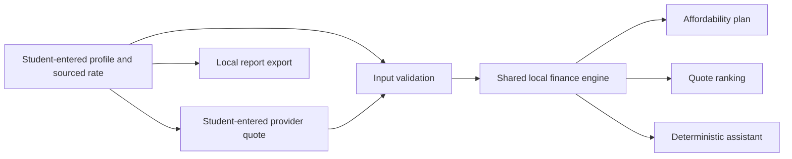

# Architecture

## Current app

Static browser app. `index.html` holds the student journey; `app.js` manages local state, provider handoff links, quote forms, report generation, and UI; `lib/finance.js` validates and calculates tuition affordability and ranks user-entered quotes. There is no server or remote API.

## Supported corridors

- Bangladesh → UK (BDT → GBP), primary product journey.
- Bangladesh → US (BDT → USD).
- Bangladesh → Canada (BDT → CAD).

These are product destinations, not a claim that any specific provider supports each route. Institution and payment-origin support must be confirmed.

## Data and limits

No default monetary values are present. The student enters their own figures, the source/timestamp of the planning FX rate, and individual provider quote details. The app calculates locally and does not independently verify user input. The report file is generated locally. Inputs are not saved or sent to a server by this build.

The external Convera and Flywire links open official student portals. They are not API integrations. No bank login, credential collection, payment initiation, or transfer execution is implemented.
